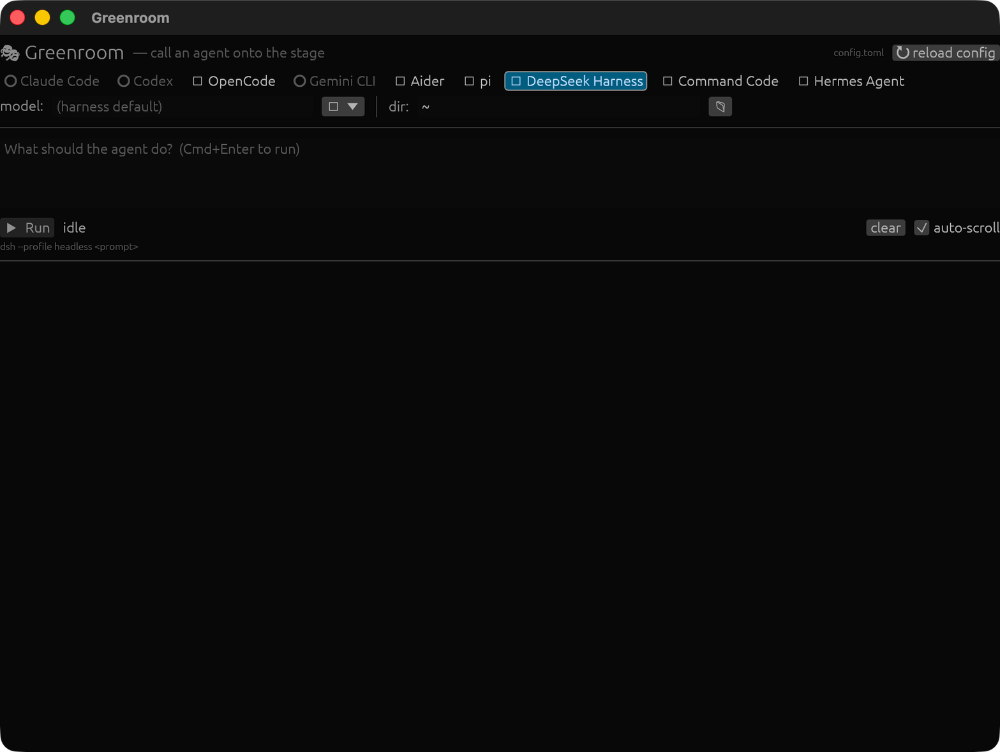

# 🎭 Greenroom

**Call any coding-agent harness onto the stage.**

You have several AI coding agents installed — Claude Code, Codex, OpenCode, Aider,
pi, dsh, cmd, Hermes… Each one has its own flags, its own models, its own mood.
Greenroom gives them **one stage**: pick an agent, pick a model, hand it a prompt,
watch the output stream.



## What it is

- **One small native window.** Rust + egui. No Electron, no webview, no browser.
- **Runs the CLIs you already have** and trust — no API keys stored, no new auth.
  Every agent keeps its own configuration; Greenroom is only the stage manager.
- **Config-driven, zero code changes to add a harness.** Presets for common CLIs
  ship in the config; anything with a headless mode can be added in five lines.
- **Prompts go as argv, never through a shell.** Quotes, `$vars`, `$(…)` stay
  literal — exactly one argument to the agent.
- **Cancel means cancel.** The whole process group is signalled, children included.
- **Installs as a normal macOS app** — drag Greenroom.app into /Applications.

## Install

Download **Greenroom.dmg** from the [latest release](../../releases/latest) and
drag it into Applications (Apple Silicon, macOS 11+).

Or build from source (requires Rust 1.85+):

```bash
git clone https://github.com/SeptianRin/greenroom && cd greenroom
cargo build --release          # binary at target/release/greenroom
./scripts/package.sh           # Greenroom.app + Greenroom.dmg in dist/
```

## Use

Run it, pick an agent (grey dot = binary not found on `$PATH`), optionally type or
pick a model, choose the working directory, write the prompt, **Run**. Output
streams live; `Cmd+Enter` also runs; **Cancel** signals the process group.

The first run creates `~/.config/greenroom/config.toml`. Hit **↻ reload config**
after editing it — no restart needed.

## Configure an agent

Everything is one TOML file. A harness is:

```toml
[[harness]]
name = "OpenCode"
bin = "opencode"                              # resolved via $PATH
args = ["run", "{prompt}"]                    # {prompt} → your prompt, one argv item
model_args = ["--model", "{model}"]           # inserted when a model is picked
models = ["opencode-go/deepseek-v4-flash"]    # picker presets (free typing always allowed)
```

- `{prompt}` is substituted with your prompt; `{model}` with the picked model.
- No model picked? A bare `{model}` — and the flag right before it — is dropped.
- Some CLIs want the model somewhere special: put `{model}` directly into `args`
  and the flag placement is up to you.
- Anything with a non-interactive mode works — see the presets in your config
  and tweak flags to match your CLI version.

### Presets shipped

| Harness | One-shot invocation |
|---|---|
| Claude Code | `claude -p "{prompt}"` |
| Codex | `codex exec "{prompt}"` |
| OpenCode | `opencode run "{prompt}"` |
| Gemini CLI | `gemini -p "{prompt}"` |
| Aider | `aider --message "{prompt}" --yes` |
| pi | `pi -p "{prompt}" --no-session` |
| DeepSeek Harness | `dsh --profile headless "{prompt}"` |
| Command Code | `cmd -p "{prompt}" --max-turns 1 --no-session` |
| Hermes Agent | `hermes chat -q "{prompt}" --oneshot -Q` |

## Why "Greenroom"?

Performers wait in the greenroom until someone calls them up. Your agents do too:
they sit backstage, warmed up and ready, until you point at one and hand it the task.
One stage, many acts.

## Roadmap

- run history and diffing output between agents
- queued prompts / staging multiple acts
- PTY mode for CLIs that insist on a terminal
- Windows & Linux packaging (the core is cross-platform Rust)

## License

MIT © Septian Rinaldi Rianggoro
